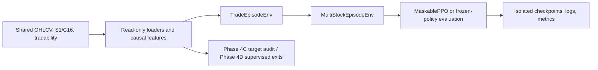

# Stock RL trade-episode research

**Status: parked (2026-10-25).** This is an isolated research branch, not the production RL runtime and not a deployment candidate. The worktree is `/home/manh/stocks-ecosystem-worktrees/rl-trade-episode`, branch `exp/stock-rl-trade-episode`. The original stock ecosystem, Alpha Lab, and shared data remain separate.

## Motivation and scope

The experiment asked whether a masked PPO policy can learn when to enter and exit one long position using causal daily observations and a trade-level terminal objective. Later phases tested whether market and Alpha Lab features contain useful predictive information, whether PPO beats simpler behavior, and whether supervised learning can convert SELL-versus-HOLD labels into an executable exit rule. The evidence has not established a robust trading advantage. See [RESEARCH_FINDINGS.md](RESEARCH_FINDINGS.md) and [FUTURE_RESEARCH.md](FUTURE_RESEARCH.md).

## Architecture



Key implementation files:

| Concern | File |
|---|---|
| Single-stock Gymnasium environment, accounting, masks, reward, truncation | [`environment.py`](../../vn_stock_rl/trade_episode/environment.py) |
| Multi-stock ticker/start sampling, ticker-free observation | [`multi_stock_environment.py`](../../vn_stock_rl/trade_episode/multi_stock_environment.py) |
| Causal, stock-specific rolling feature scaling | [`causal_features.py`](../../vn_stock_rl/trade_episode/causal_features.py) |
| Point-in-time Parquet readers and shared-data root | [`data.py`](../../vn_stock_rl/trade_episode/data.py) |
| Phase 4A preparation, universes, partitions, environment builders | [`phase4a_data.py`](../../vn_stock_rl/trade_episode/phase4a_data.py) |
| MaskablePPO training and mask-aware evaluation | [`training.py`](../../vn_stock_rl/trade_episode/training.py), [`train_cli.py`](../../vn_stock_rl/trade_episode/train_cli.py) |
| Phase runners | `phase3_experiment.py`, `phase4a_experiment.py`, `phase4b_experiment.py`, `phase4c_target_alignment.py`, `phase4d_experiment.py` under `../../vn_stock_rl/trade_episode/` |
| Frozen experiment definitions | [`configs/trade_episode/`](../../configs/trade_episode/) |
| Protocols and versioned metrics | this directory and its `phase4b/`, `phase4c/`, `phase4d/` subdirectories |

## Environment contract

- **Episode:** starts OUT with normalized capital 1 and represents cash waiting plus at most one completed long trade. There is no leverage, shorting, partial sizing, transaction fee, tax, or slippage.
- **Actions:** `Discrete(2)`, `0=OUT`, `1=IN`. OUT+OUT waits; OUT+IN buys; IN+IN holds; IN+OUT sells. There is no separate HOLD action.
- **Observation time and execution:** observe through close `t`, submit the target-position action, and fill at the next legal open. Same-close execution is not used. Shared daily tradability flags can block a BUY or SELL.
- **Minimum hold:** a SELL is masked until its next-open fill would be at least three trading-row intervals after the BUY fill. The mask is supplied to MaskablePPO rollout collection, evaluation, and prediction.
- **Reward:** every non-SELL step returns zero. A valid SELL terminates the episode and returns, without clipping or normalization,

  ```text
  R = (252 / T) * ln(P_sell / P_buy) - ln(1.07)
  ```

  Here `T` is the fill-to-fill trading interval count. This is annualized excess log return **per trade**, not portfolio CAGR or percentage profit. `gamma=1.0` is fixed in the experiment configuration.
- **Boundaries:** data end and finite episode/wait/holding limits truncate; they do not fabricate a SELL or terminal trade reward. Open positions are marked to market for diagnostics. Phase 2/4A PPO configs allowed 756 episode steps, 252 waiting steps, and 756 holding intervals. Phase 4D's supervised exit controller instead used a 40-interval maximum horizon. These are experiment caps, not learned exits.
- **Policy and exploration:** the action-mask-aware `MaskablePPO` MLP is used instead of the standard PPO class. Training samples legal actions from the policy distribution with an entropy coefficient of `0.01`; no epsilon-greedy or hand-coded exploration schedule is present. The Phase 4A default is CPU, one worker, 256 rollout steps, batch size 64, five epochs, learning rate `3e-4`, GAE lambda `0.95`, and a `[64, 64]` MLP. Phase 4A also randomizes ticker and episode start. These settings are small experimental budgets, not evidence that optimization has converged.

## Observations and preprocessing

Phase 4A's baseline has nine causal market features and five agent-state fields (14 inputs). The Alpha condition adds S1 and C16 values plus one availability bit for each (18 inputs). No ticker name, ID, one-hot value, or embedding enters the policy observation.

| Group | Features and construction |
|---|---|
| Market (9) | 1/5/20-session log returns, intraday log return, overnight gap, high/low log range, 20-day realized volatility, lagged 60-day volatility, and 20-day log-volume z-score. Return-like features are scaled by that stock's volatility through `t-1` (five/20-day returns also by `sqrt(horizon)`); a 0.005 daily-volatility floor is used. Volatility features are log-scaled; volume normalization uses only prior 20 sessions. |
| Alpha (4) | S1 `xs_proba` and availability; C16 `order_volume_ratio_rank` and availability. Values stay in `[0,1]`; unavailable values use a 0.5 sentinel with the availability bit authoritative. S1's target label is not loaded. The artifacts do not carry complete publication timestamps, so after-close availability relies on the producer's documented timing contract. |
| Agent state (5) | `position_in`; normalized holding intervals; entry-relative unrealized log return scaled by entry-time volatility and `sqrt(holding intervals)`; normalized waiting steps; normalized episode steps. |

The Phase 4A shared policy samples one ticker at a time in a randomized cycle and chooses a legal chronological training start for that ticker. Each episode then advances chronologically. The same observation dimensions and action semantics are used across tickers. Twelve tickers were eligible for fitting; DGC, MBB, and VHC were held out from fitting and threshold selection. They are unseen-to-training test tickers, not a pristine or broad universe sample. BCG was retained partly for ended/suspended-history coverage; survivorship bias remains possible.

## Data, objective, and evaluation limits

The actual shared root used by the later runs was `/home/manh/stocks-ecosystem/data`; set `STOCKS_DATA_ROOT` explicitly. The worktree does not contain a dataset copy. Loaders read Parquet through read-only handles and Phase 4A filters dates before feature construction. Experiments use 2015–2019 for training, 2020–2022 for validation, and 2023–2025 for exploratory evaluation. No 2026 observation was used. The user confirmed dividend-adjusted prices as the working assumption; no independent adjustment-factor audit was performed.

Alpha discovery used the 2015–2025 research panel. Validation and 2023–2025 findings therefore are not independent tests of the selected Alpha signals. Repeated evaluation and only three unseen tickers limit inference. Per-stock CAGR averages are separate paths, not a realizable multi-stock portfolio: no cross-stock allocation rule was specified. The annualized per-trade reward ignores cash waiting time and trade frequency, so always report it separately from chronological compounded returns, CAGR, drawdown, exposure, and trade counts.

## Setup and verification

The experiment was run in the workspace's Python 3.10 `stocks` environment on CPU. The recorded environment included Gymnasium 0.29.1, Stable-Baselines3 2.4.1, sb3-contrib 2.4.0, PyTorch 2.11.0, NumPy 1.26.4, pandas 2.3.3, PyArrow 24.0.0, scikit-learn 1.7.2, and joblib 1.4.2. Tests used pytest 8.3.4 and Ruff 0.8.4. The package declares broader version ranges in [`pyproject.toml`](../../pyproject.toml); the workspace lock is a direct-dependency lock, not a complete transitive hash lock. No peak-memory measurements were saved. Training/evaluation was CPU-only and single-worker; observed historical durations ranged from about 31 seconds (Phase 3) to 167 seconds (Phase 4A) and 765 seconds (Phase 4B).

Use the existing environment; installation is not needed when it is already provisioned:

```bash
cd /home/manh/stocks-ecosystem-worktrees/rl-trade-episode/RL-trading-agent
conda activate stocks
export PYTHONPATH=.
export STOCKS_DATA_ROOT=/home/manh/stocks-ecosystem/data
```

Focused branch-health checks (71 tests passed at hibernation):

```bash
PYTHONPATH=. python -m pytest -q \
  tests/test_trade_episode.py tests/test_phase4a.py tests/test_phase4b.py \
  tests/test_phase4c_target_alignment.py tests/test_phase4d_policy.py \
  tests/test_phase4d_prediction_support.py tests/test_phase4d_statistics.py \
  tests/test_phase4d_supervised.py
python -m ruff check vn_stock_rl/trade_episode \
  tests/test_trade_episode.py tests/test_phase4a.py tests/test_phase4b.py \
  tests/test_phase4c_target_alignment.py tests/test_phase4d_policy.py \
  tests/test_phase4d_prediction_support.py tests/test_phase4d_statistics.py \
  tests/test_phase4d_supervised.py
```

## Reproducing saved runs

The following entry points and flags were verified with `--help`; full experiments were **not** run during hibernation. Choose new, empty output locations for every run. Phase 2–4A training output roots must also satisfy the isolation checks and remain outside the workspace and shared data root.

```bash
# Phase 2 wiring smoke only: 64 steps for one FPT condition.
RUN_ROOT=/home/manh/stocks-ecosystem-runs/rl-trade-episode/repro-$(date +%Y%m%d%H%M%S)
PYTHONPATH=. python -m vn_stock_rl.trade_episode.train_cli \
  --config configs/trade_episode/baseline_market.json \
  --data-root "$STOCKS_DATA_ROOT" --output-root "$RUN_ROOT/phase2" --smoke

# Phase 3 FPT comparison (three seeds × 5,120 steps).
PYTHONPATH=. python -m vn_stock_rl.trade_episode.phase3_experiment \
  --output-root "$RUN_ROOT/phase3" --timesteps 5120

# Phase 4A multi-stock comparison (six models × 12,288 steps).
PYTHONPATH=. python -m vn_stock_rl.trade_episode.phase4a_experiment \
  --output-root "$RUN_ROOT/phase4a" --timesteps 12288
```

Phase 4B and Phase 4D require a clean worktree and frozen Phase 4A files under `/tmp/stock-rl-trade-episode-phase4a-20261025/`. Their committed result directories must not be used as output destinations. The following examples copy the configs to `/tmp`, retarget outputs, and preserve the committed definitions:

```bash
# Phase 4B: frozen PPO plus randomized controls; requires the Phase 4A checkpoints.
python - <<'PY'
import json
from pathlib import Path
config = json.loads(Path("configs/trade_episode/phase4b_falsification.json").read_text())
config["outputs"]["root"] = "RL-trading-agent/artifacts/trade_episode/phase4b-replay"
Path("/tmp/phase4b-replay.json").write_text(json.dumps(config, indent=2) + "\n")
PY
PYTHONPATH=. python -m vn_stock_rl.trade_episode.phase4b_experiment \
  --config /tmp/phase4b-replay.json

# Phase 4C: target-alignment audit; use a fresh external result directory.
PYTHONPATH=. python -m vn_stock_rl.trade_episode.phase4c_target_alignment \
  --data-root "$STOCKS_DATA_ROOT" --output-dir "$RUN_ROOT/phase4c"

# Phase 4D: fixed-entry supervised exits; no PPO retraining.
python - <<'PY'
import json
from pathlib import Path
config = json.loads(Path("configs/trade_episode/phase4d_supervised_exit.json").read_text())
config["results_dir"] = "RL-trading-agent/artifacts/trade_episode/phase4d-replay/results"
config["isolated_model_dir"] = "RL-trading-agent/artifacts/trade_episode/phase4d-replay/models"
Path("/tmp/phase4d-replay.json").write_text(json.dumps(config, indent=2) + "\n")
PY
PYTHONPATH=. python -m vn_stock_rl.trade_episode.phase4d_experiment \
  --config /tmp/phase4d-replay.json --data-root "$STOCKS_DATA_ROOT"
```

Phase 4B's output root is relative to the worktree root. Phase 4D resolves result/model paths from the worktree root, requires the branch to be clean, and refuses existing non-empty outputs. The examples above are reproduction instructions only; they were not run during hibernation. A fresh run should have a new protocol/run ID and output directory rather than reuse these illustrative names.

## Artifact retention

Source, tests, configs, protocols, Phase 4B–4D metrics, and phase reports are versioned. Phase 2 smoke bundles, Phase 3 outputs, Phase 4A outputs, and six Phase 4A frozen PPO checkpoints currently exist under `/tmp/stock-rl-trade-episode-*-20261025/`; `/tmp` is not durable archival storage. The Phase 4A manifest records their hashes but explicitly has no checkpoint-generating Git SHA. Phase 4D's six supervised joblib models remain in the ignored `artifacts/trade_episode/phase4d-20261025-run2/` directory; their hashes and paths are in the versioned `phase4d_metrics.json`. Check these paths and hashes before relying on the models. Shared data is not in Git and must be available at `STOCKS_DATA_ROOT`.
